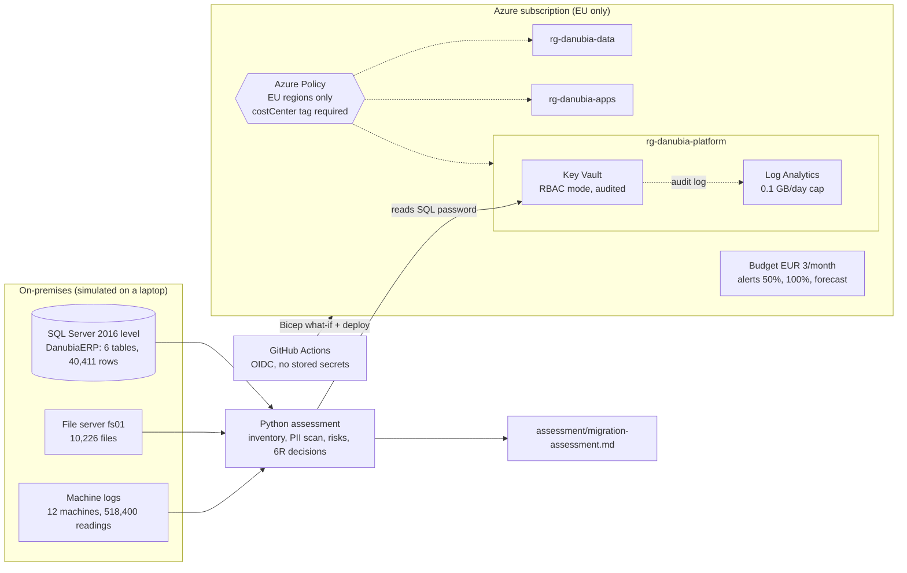

# Danubia Goes Azure

**A fictional 250-employee Slovak manufacturer moves from its own server room to Microsoft Azure: end to end, as code, for under EUR 3 a month.**

Danubia Components s.r.o. makes metal and plastic parts for automotive and appliance customers in Slovakia, Hungary, Austria and Germany. Its SQL Server is out of support, its file server holds 10,000 unmanaged files, and nobody knows who can read the payroll data. This repository is the migration programme, split into ten projects. Each project builds on the last one.

| # | Project | Status |
|---|---------|--------|
| 1 | **Cloud foundation, guardrails and on-prem simulation** | ✅ Done |
| 2 | Identity for 250 staff (Entra ID, MFA, least privilege) | Next |
| 3 | ERP database migration (SQL Server to Azure SQL) | Planned |
| 4 | File server migration (Blob Storage, tiers, PII protection) | Planned |
| 5 | Invoice automation (Document Intelligence) | Planned |
| 6 | Intranet modernisation (Container Apps) | Planned |
| 7 | Integration and events (Service Bus, Logic Apps) | Planned |
| 8 | Machine data and analytics (Data Explorer) | Planned |
| 9 | Internal AI assistant (Azure OpenAI, AI Search) | Planned |
| 10 | Operations, disaster recovery and FinOps | Planned |

---

## Project 1: foundation and guardrails

Every real migration starts here, and most portfolios skip it: nothing is moved yet, but every later project lands inside these guardrails.



### What was built

**1. A realistic on-premises estate, generated by code** (`src/danubia/simulate/`)
- **ERP database** on SQL Server 2022 in Docker, set to compatibility level 130 so it behaves like the company's SQL Server 2016: departments, 250 employees, 400 customers, 300 products, 20,000 orders and 19,453 invoices with keys and indexes. About EUR 42 million revenue a year, which is right for a company this size.
- **File server** with 10,226 files: 3,000 PDF supplier invoices, HR personnel files, quality reports, price lists, and the usual mess (`budget_final_v2.csv`, "Copy of" duplicates). File ages go back to 2011.
- **Planted risks** that a real assessment always finds: an HR export with birth numbers and IBANs in a public folder, and plain-text admin passwords in an IT notes file. All data is fake.
- **Machine logs**: one reading per minute for 30 days from 12 machines, with two hidden faults for Project 8.

**2. A migration assessment, as code** (`src/danubia/assess/inventory.py`)
It does what a consultant, or Azure Migrate with its appliance, does in week one:
- Database: version, size, backups, keys, indexes, and **sensitive columns found by sampling the data**, not only by column names.
- Files: SHA-256 fingerprints to prove duplicates, personal-data patterns, credential-like lines, and a storage-tier plan by file age.
- A report with findings by severity and a **6R decision per workload** (rehost, replatform, refactor, ...). It contains counts and paths only, never personal data, so it is safe to publish.

**Result:** [assessment/migration-assessment.md](assessment/migration-assessment.md): 1 critical, 3 high, 1 medium and 1 low finding; 55% of the files are unchanged for 2+ years and can go straight to cheaper storage tiers.

**3. A landing zone in Bicep** (`infra/`)

| Control | How |
|---|---|
| Separation of duties by lifecycle | Three resource groups: platform, data, apps |
| GDPR data residency | Built-in *Allowed locations* policy: EU regions only, **Deny** |
| Cost accountability | Built-in *Require a tag* policy: every resource needs `costCenter`, **Deny** |
| Spending limit | EUR 3/month budget for the whole subscription, alerts at 50%, 100% and forecast 100% |
| Audit trail | Subscription Activity Log and Key Vault audit logs to Log Analytics |
| Logging cannot blow the budget | Log Analytics daily cap of 0.1 GB |
| Secrets | Key Vault in RBAC mode; the SQL password lives only there |

Both policies were tested by trying to break them: a resource in `eastus` and a resource without a `costCenter` tag were both refused with Danubia's own messages.

**4. Deployment without stored secrets** (`.github/workflows/platform.yml`)
- Pull request: Bicep lint and a **what-if preview** of what would change.
- Merge to `main`: deploy.
- GitHub signs in to Azure with **OpenID Connect**: short-lived tokens, trusted only for this repository's `main` branch and pull requests. No client secret exists anywhere. The trust rules include GitHub's immutable owner and repository IDs, so a renamed or re-created repository with the same name cannot impersonate this one.
- The pipeline identity has Contributor and Resource Policy Contributor rights only. It cannot grant access to anyone, so it cannot escalate its own permissions.

**5. Secrets out of files**
The SQL password moved from `.env` into Key Vault. Python reads it with `DefaultAzureCredential`, which uses the developer's `az login` session on a laptop and a managed identity inside Azure, so the same code works in both places. Every read is logged; see [docs/queries/keyvault-secret-access.kql](docs/queries/keyvault-secret-access.kql).

### Cost

| Item | Monthly cost |
|---|---|
| Resource groups, policies, budget, RBAC | EUR 0 |
| Log Analytics (capped, within the free 5 GB) | EUR 0 |
| Activity Log ingestion | EUR 0 |
| Key Vault (a few operations) | < EUR 0.01 |
| Defender for Cloud (free Foundational CSPM) | EUR 0 |
| **Total for Project 1** | **~EUR 0** |

### Honest trade-offs (demo vs. production)

| Demo choice | Production choice | Why the demo differs |
|---|---|---|
| Public endpoints with Entra ID auth | Private endpoints, hub-and-spoke network | Private endpoints cost ~EUR 7/month each |
| Key Vault soft delete 7 days, no purge protection | 90 days + purge protection | Lets the demo be torn down and rebuilt |
| Policies per Danubia resource group | Policies on a management group | The subscription also holds older projects |
| Pipeline has Contributor on the subscription | Custom role scoped to the landing zone | Tightened in Project 2 |
| Security defaults | Conditional Access + PIM (Entra ID P1/P2) | Licences not included in the budget |

Defender for Cloud secure score: baseline pending first assessment; recorded at the start of Project 2.

Decisions are documented in [docs/adr/0001-landing-zone.md](docs/adr/0001-landing-zone.md).

---

## Run it yourself

**Prerequisites:** Windows with PowerShell, Docker Desktop, Python 3.12+ with [uv](https://docs.astral.sh/uv/), Azure CLI, an ODBC driver for SQL Server, an Azure subscription.

```powershell
# 1. Python environment
uv sync
Copy-Item .env.example .env   # then edit .env

# 2. Simulated on-prem estate
.\scripts\start-onprem-sql.ps1
uv run python -m danubia.simulate.erp
uv run python -m danubia.simulate.fileshare
uv run python -m danubia.simulate.machines

# 3. Assessment
uv run python -m danubia.assess.inventory

# 4. Landing zone (what-if preview, then confirm)
az login
.\scripts\deploy-landing-zone.ps1

# 5. GitHub OIDC (once), then add the printed IDs as repository variables
.\scripts\setup-github-oidc.ps1 -Repo "<owner>/<repo>"
```

## Repository layout

```
assessment/        generated migration assessment
docs/              company profile, decision records, KQL queries
infra/             Bicep: main.bicep, modules/, parameters
scripts/           PowerShell helpers (SQL container, deploy, OIDC setup)
src/danubia/       Python: simulate/ (generators), assess/ (inventory), config.py
.github/workflows/ CI/CD pipeline
```

## Tech stack

Azure (Policy, Cost Management, Key Vault, Log Analytics, Entra ID, Defender for Cloud) · Bicep · GitHub Actions with OIDC · Python 3.14, uv, Polars, SQLAlchemy 2, Faker, Rich, azure-identity · SQL Server 2022 in Docker · KQL

## Author

**Arnold Németh** · [LinkedIn](https://www.linkedin.com/in/arnold-n%C3%A9meth-3b482597/) · [GitHub](https://github.com/arnienemeth)

All company data in this repository is fictional and generated by code.
